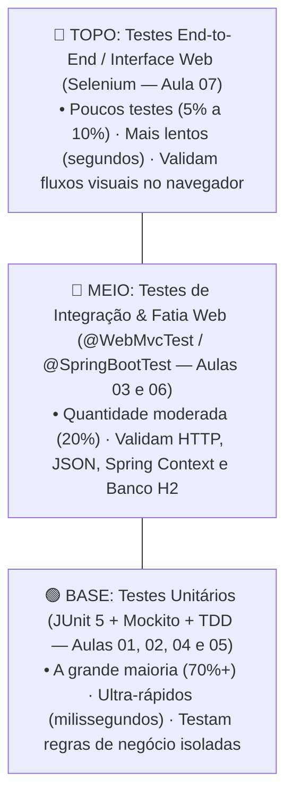
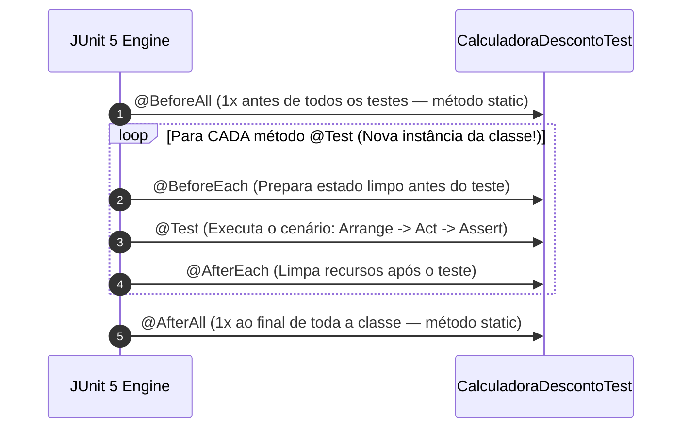

# Aula 01 — Introdução a Testes Automatizados e JUnit 5

**Prof. Wenceslau Neto · Ada Tech · Testes Automatizados (BE-JV-011)**

---

## Slide 1 — 1. O Problema: "Testar no `main` ou no Postman Não Escala!"

> 🎬 **Imagine o cenário:** Uma regra simples de desconto para clientes VIP na `CalculadoraDesconto` foi alterada. Você abre um `public static void main` (ou o Postman), testa 2 valores, vê que imprimiu o resultado certo e faz o deploy em produção. No sábado de manhã, clientes com cupom promocional conseguem **110% de desconto** (valor negativo no pedido)!

### Por que o teste manual (`TesteManualMain.java`) falha quando o sistema cresce?

| Problema do Teste Manual (`System.out.println`) | O que acontece na prática? |
| :--- | :--- |
| **1. Depende do "olhômetro" humano** | Alguém precisa ler o console e lembrar qual deveria ser o resultado correto |
| **2. Não é repetível em escala** | Ninguém re-testa manualmente 150 cenários antigos a cada `git push` |
| **3. Não bloqueia bugs no CI/CD** | Um `System.out.println` errado não retorna código de erro para travar um Pull Request |
| **4. Medo de refatorar (*Fear of Change*)** | O código fica sujo porque ninguém tem coragem de mexer no que "já está funcionando" |

---

## Slide 2 — 1. O que é um Teste Automatizado de Verdade?

Um teste automatizado é um **programa que testa outro programa** de forma determinística, rápida e sem intervenção humana.

```text
Código de Produção (CalculadoraDesconto)  <---  Código de Teste (CalculadoraDescontoTest)
                                                 1. Prepara os dados (Arrange)
                                                 2. Executa o método (Act)
                                                 3. Confere o resultado esperado (Assert)
                                                 -> Se falhar: ❌ RED (Quebra o build na hora!)
                                                 -> Se passar: ✅ GREEN (Segurança para evoluir!)
```

### Os 4 Pilares de um Bom Teste Unitário (**F.I.R.S.T.**)
- **F — Fast (Rápido):** Roda em milissegundos (você pode rodar 500 testes em 2 segundos).
- **I — Independent / Isolated (Independente):** Um teste nunca depende da ordem em que outro teste rodou.
- **R — Repeatable (Repetível):** Dá o mesmo resultado na sua máquina, no Linux do colega e no GitHub Actions.
- **S — Self-Validating (Auto-validável):** O resultado é binário (**Passou** ou **Falhou**), sem precisar ler logs.
- **T — Timely / Thorough (Oportuno e Completo):** Escrito junto com o código (ou antes, no TDD!) cobrindo caminho feliz e casos de borda.

---

## Slide 3 — 2. A Pirâmide de Testes (Mike Cohn 'Who is this guy?'')

> 🧭 **Como distribuir nossos esforços de teste ao longo do projeto?**



### Por que a base precisa ser larga e o topo estreito?
- Se você tentar testar 50 regras de cálculo abrindo o navegador Chrome (Topo), sua suíte vai demorar **20 minutos** e quebrar por qualquer mudança de CSS.
- Testando as 50 regras na **Base (Testes Unitários)**, elas rodam em **30 milissegundos** e apontam a linha exata do erro!

---

## Slide 4 — 2. Anatomia de um Teste: O Padrão AAA (*Arrange, Act, Assert*)

Todo teste bem escrito conta uma história clara dividida em **3 atos**:

```java
@Test
@DisplayName("Deve aplicar 15% de desconto para cliente VIP em compras acima de R$ 100")
void deveAplicarDescontoParaClienteVip() {
    // 1. ARRANGE (Cenário / Dado que...) -> Prepara objetos e variáveis de entrada
    CalculadoraDesconto calculadora = new CalculadoraDesconto();
    double valorCompra = 200.0;
    boolean clienteVip = true;

    // 2. ACT (Ação / Quando...) -> Executa o único método que queremos testar
    double valorFinal = calculadora.calcularValorComDesconto(valorCompra, clienteVip);

    // 3. ASSERT (Verificação / Então...) -> Confere se a saída bate com a especificação
    assertEquals(170.0, valorFinal, 0.001);
}
```

> 💡 **Dica de Legibilidade:**
> Um desenvolvedor novo no time deve bater o olho no `@DisplayName` e nos 3 blocos (**Arrange / Act / Assert**) e entender a regra de negócio da empresa **sem precisar abrir a classe de produção**!

---

## Slide 5 — 3. Por Dentro do JUnit 5 (JUnit Jupiter)

O **JUnit 5** é composto por três subprojetos: **JUnit Platform** (motor na JVM/Maven), **JUnit Jupiter** (a API moderna que usamos: `@Test`, `@BeforeEach`, `Assertions`) e **JUnit Vintage** (retrocompatibilidade com JUnit 3/4).

### Ciclo de Vida de uma Classe de Teste no JUnit 5



- ⚠️ **Por que o `@BeforeEach` é tão importante?**
  Porque ele garante o **"I" (Isolamento)** do F.I.R.S.T.: cada `@Test` recebe um objeto `new CalculadoraDesconto()` ou `new ContaBancaria()` zerado, evitando que um teste "suje" a memória do próximo!

---

## Slide 6 — 3. As Principais Asserções do JUnit 5 (`Assertions.*`)

| Método de Asserção | Quando utilizar? | Exemplo Prático (`aula01`) |
| :--- | :--- | :--- |
| **`assertEquals(esperado, atual)`** | Comparar valores exatos (números, Strings, objetos com `equals`) | `assertEquals(180.0, resultado);` |
| **`assertTrue(condicao)` / `assertFalse(...)`** | Validar retornos booleanos ou estados lógicos | `assertTrue(conta.isAtiva());` |
| **`assertThrows(Excecao.class, () -> ...)`** | **Garantir que o método bloqueia entradas inválidas lançando a exceção certa!** | `assertThrows(IllegalArgumentException.class, () -> calc.calcular(-50, false));` |
| **`assertAll(heading, () -> ..., () -> ...)`** | Agrupar várias asserções do mesmo objeto sem parar na primeira falha | Validar saldo, titular e status da `ContaBancaria` de uma só vez |
| **`assertNotNull(obj)` / `assertNull(obj)`** | Garantir presença ou ausência de referência | `assertNotNull(comprovante);` |

---

## Slide 7 — 4. Testando Exceções e Casos de Borda (*Edge Cases*)

> 🚨 **Erro Clássico de Iniciante:** Testar apenas o *"Caminho Feliz"* (*Happy Path*)!

Os bugs mais caros em produção moram nas **fronteiras (*Boundary Values*)** e nas **entradas inválidas**:

```java
@Test
@DisplayName("Deve lançar IllegalArgumentException quando valor da compra for negativo")
void deveLancarExcecaoParaValorNegativo() {
    IllegalArgumentException exception = assertThrows(
            IllegalArgumentException.class,
            () -> calculadora.calcularValorComDesconto(-10.0, false)
    );

    // Além do tipo da exceção, validamos a mensagem de erro!
    assertEquals("O valor da compra não pode ser negativo.", exception.getMessage());
}
```

### Checklist de Casos de Borda para Sempre Testar:
1. **Zeros e Limites Exatos:** O que acontece quando a compra é exatamente `R$ 0,00` ou exatamente no limite do desconto (`R$ 100,00` vs `R$ 100,01`)?
2. **Valores Negativos:** Preço negativo, peso negativo, saque negativo.
3. **Nulos e Strings Vazias:** `"   "`, `""`, `null`.
4. **Limites Superiores (Teto):** O desconto acumulado nunca pode ultrapassar o teto máximo permitido!

---

## Slide 8 — 5. Testes Parametrizados (`@ParameterizedTest` + `@CsvSource`)

E quando queremos testar a mesma fórmula matemática com **5 faixas de valores diferentes** sem copiar e colar 5 métodos `@Test` idênticos?

```java
@ParameterizedTest(name = "Compra de R$ {0} (VIP={1}) deve resultar em R$ {2}")
@CsvSource({
        "50.0,  false, 50.0",   // Sem desconto
        "100.0, false, 95.0",   // 5% desconto padrão
        "200.0, true,  170.0",  // 15% desconto VIP
        "1000.0, true, 800.0"   // 20% desconto máximo
})
void deveCalcularDescontoCorretamentePorFaixa(double valor, boolean vip, double esperado) {
    double resultado = calculadora.calcularValorComDesconto(valor, vip);
    assertEquals(esperado, resultado, 0.001);
}
```

---

## Slide 9 — Pesquisa Guiada + Mão na Massa

### 🔎 Parte 2 — Pesquisa Individual Guiada (4 Questões)
1. **Arquitetura do JUnit 5:** Qual o papel de *JUnit Platform*, *JUnit Jupiter* e *JUnit Vintage*?
2. **Ciclo de Vida:** Qual a diferença prática entre `@BeforeEach` e `@BeforeAll`?
3. **Asserções Agrupadas:** Por que `assertAll(...)` é melhor do que 4 `assertEquals` soltos quando validamos vários campos de um objeto?
4. **Testes Parametrizados:** Como `@ParameterizedTest` e `@CsvSource` reduzem duplicação de código nos testes de fronteira?

### 🛠️ Parte 3 — Exercícios Práticos no Pacote `com.ada.demo.aula01`
1. **`CalculadoraFreteTest`:** Testar cálculo de frete por peso, distância, isenção para compras acima de R$ 500 e exceções para peso/distância inválidos.
2. **`ContaBancariaTest`:** Testar depósito, saque dentro do saldo, bloqueio de saque sem saldo suficiente (`IllegalStateException`), transferência entre contas e validações de valores negativos.
