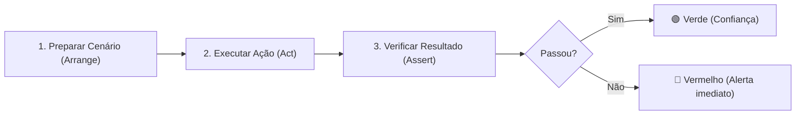
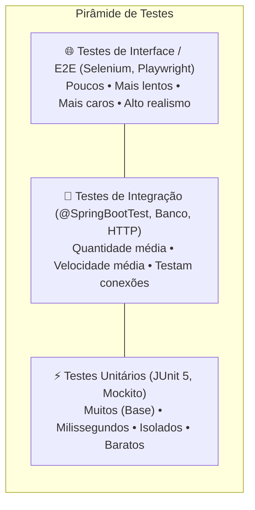

# Aula 01 — Introdução a Testes Automatizados

> **Módulo:** Testes Automatizados  
> **Objetivo da aula:** Compreender por que testamos software de forma automatizada, conhecer os principais tipos de testes (Pirâmide de Testes), entender a anatomia de um bom teste (Padrão AAA) e implementar os primeiros testes automatizados com **JUnit 5**.

---

## 1. Estudo de Caso: Por que utilizar testes automatizados?

### O Cenário Real: Sexta-feira, 17h30

Imagine que você trabalha em um e-commerce e precisa manter a classe [`CalculadoraDesconto`](../src/main/java/com/ada/demo/aula01/CalculadoraDesconto.java), responsável por aplicar descontos no carrinho de compras:

1. **Compras abaixo de R$ 100,00:** sem desconto (`0%`).
2. **Compras de R$ 100,00 até 499,99:** `5%` de desconto.
3. **Compras a partir de R$ 500,00:** `10%` de desconto.
4. **Clientes VIP:** ganham `+5%` de desconto adicional em qualquer compra válida.

### Como costumamos testar quando estamos aprendendo?

Normalmente criamos um método `main` (veja [`TesteManualMain`](../src/main/java/com/ada/demo/aula01/TesteManualMain.java)), rodamos o programa e "olhamos no console" se os números parecem certos:

```java
public static void main(String[] args) {
    CalculadoraDesconto calc = new CalculadoraDesconto();
    System.out.println(calc.calcularValorFinal(200.0, false)); // Esperado: 190.0
    System.out.println(calc.calcularValorFinal(600.0, true));  // Esperado: 510.0
}
```

### Onde mora o perigo? (Perguntas para discussão)

1. **Inspeção visual falha:** Se tivermos 40 cenários impressos no console, quem garante que alguém conferiu linha por linha após uma alteração?
2. **Efeito colateral (Regressão):** Quando um desenvolvedor altera um `if` para corrigir um caso de borda (ex.: exatamente R$ 500,00), como saber imediatamente se ele não quebrou a regra do cliente comum?
3. **Escalabilidade:** Em um sistema real com 300 classes de negócio, quanto tempo levaria testar tudo manualmente no Postman ou via `main()` a cada mudança?

> [!IMPORTANT]
> **Regressão** ocorre quando uma funcionalidade que **já funcionava** deixa de funcionar após uma alteração no código ou adição de uma nova funcionalidade. Testes automatizados são a nossa **rede de segurança contra regressões**.

---

## 2. O que são Testes Automatizados?

Um **teste automatizado** é um trecho de código que executa outro trecho de código (o *System Under Test* — SUT) com entradas conhecidas e **verifica automaticamente** se o resultado obtido corresponde ao resultado esperado — sem depender de um humano olhando para a tela.



### Anatomia de um Teste: O Padrão AAA (Arrange, Act, Assert)

Todo bom teste segue uma estrutura clara de 3 etapas (também conhecida em português como **Dado / Quando / Então**):

1. **Arrange (Preparar / Cenário):** Instanciamos os objetos e preparamos os dados de entrada necessários para o teste.
2. **Act (Agir / Execução):** Chamamos **o método** que queremos testar.
3. **Assert (Verificar / Asserção):** Comparamos o resultado retornado (ou efeito gerado) com o valor esperado usando asserções do framework de testes.

### Exemplo Prático com JUnit 5

Veja como um cenário manual do `main()` se transforma em um teste automatizado em [`CalculadoraDescontoTest`](../src/test/java/com/ada/demo/aula01/CalculadoraDescontoTest.java):

```java
@Test
void deveAplicarCincoPorCentoEmCompraDeDuzentosReaisParaClienteComum() {
    // 1. Arrange (Preparar)
    CalculadoraDesconto calculadora = new CalculadoraDesconto();
    double valorCompra = 200.0;
    boolean clienteVip = false;

    // 2. Act (Agir)
    double valorFinal = calculadora.calcularValorFinal(valorCompra, clienteVip);

    // 3. Assert (Verificar)
    assertEquals(190.0, valorFinal, 0.001);
}
```

### Boas práticas para nomes de testes

O nome do teste deve contar **qual regra de negócio quebrou** sem que você precise ler o código inteiro. Exemplos de convenções comuns no mercado:
* `deveAplicarDezPorCentoQuandoCompraForAciMaDeQuinhentosReais()`
* `calcularValorFinal_compraAcimaDe500_retornaDezPorCentoDeDesconto()`
* `givenCompraDe200_whenCalcularValorFinal_thenRetorna190()`

---

## 3. Comparação entre os Diferentes Tipos de Testes

Nem todo teste automatizado testa a mesma coisa. Na engenharia de software, organizamos os testes na chamada **Pirâmide de Testes** (conceito popularizado por Mike Cohn):



### Tabela Comparativa

| Característica | Testes Unitários | Testes de Integração | Testes de Interface (E2E / UI) |
| :--- | :--- | :--- | :--- |
| **O que testa?** | Uma unidade isolada (classe/método) sem recursos externos | A comunicação entre componentes reais (API + Banco de Dados + Mensageria) | O sistema completo pela visão do usuário final (Navegador / Tela) |
| **Velocidade** | Muito rápida (milissegundos por teste) | Moderada (segundos — sobe contexto do Spring/banco) | Lenta (dezenas de segundos ou minutos — abre navegador) |
| **Custo de criação/manutenção** | Baixo | Médio | Alto (mudanças visuais podem quebrar o teste) |
| **Diagnóstico de falha** | Aponta exatamente a linha/regra que quebrou | Indica falha na integração (SQL, serialização JSON, configuração) | Indica que o fluxo falhou, mas exige investigação para achar a causa |
| **Ferramentas no Curso** | **JUnit 5 + Mockito** (Aulas 1 a 5) | **Spring Boot Test + MockMvc + H2** (Aula 6) | **Selenium WebDriver** (Aula 7) |

> [!TIP]
> **Por que formato de pirâmide?**  
> Porque queremos que **a maior parte dos nossos testes seja unitária** (rápida, barata e precisa), complementada por uma camada sólida de **testes de integração** (para garantir que as peças se encaixam) e alguns **testes de ponta a ponta (UI)** nos fluxos mais críticos do negócio.

---

## 4. Pesquisa Individual Guiada (20 minutos)

Consulte a documentação oficial do **[JUnit 5 User Guide](https://junit.org/junit5/docs/current/user-guide/)** (especialmente as seções *Writing Tests*, *Annotations* e *Assertions*) e responda às 4 questões abaixo:

1. **Nomes legíveis nos relatórios:** Qual anotação do JUnit 5 permite exibir uma frase amigável (com espaços, acentos e emojis) no relatório de execução do teste, em vez do nome do método Java?
2. **Testando erros e validações:** Qual método da classe `Assertions` usamos para verificar que um método **lançou uma exceção** esperada (por exemplo, `IllegalArgumentException` quando o valor da compra é negativo)?
3. **Ciclo de vida do teste:** Qual é a diferença prática entre as anotações `@BeforeEach` e `@BeforeAll`? Quando usamos `@BeforeEach` para instanciar a classe que será testada?
4. **Além do `assertEquals`:** Cite pelo menos **3 outros métodos de asserção** do JUnit 5 e explique em qual situação cada um é mais adequado do que o `assertEquals`.

---

## 5. Exercícios Práticos de Fixação

Agora é a sua vez! No pacote `aulas`, temos duas classes de negócio prontas e uma suíte de testes para você completar.

### Exercício 1 — Completar os testes da `CalculadoraDesconto`
Abra [`CalculadoraDescontoTest.java`](../src/test/java/com/ada/demo/aula01/CalculadoraDescontoTest.java):
1. Execute os testes existentes e encontre o **bug de caso de borda** escondido na implementação de [`CalculadoraDesconto.java`](../src/main/java/com/ada/demo/aula01/CalculadoraDesconto.java).
2. Corrija o bug na classe `CalculadoraDesconto` e veja todos os testes ficarem verdes.
3. Adicione testes para valores inválidos (compra negativa ou zero) usando `assertThrows`.

### Exercício 2 — Criar os testes da `CalculadoraFrete`
Analise as regras de negócio documentadas na classe [`CalculadoraFrete.java`](../src/main/java/com/ada/demo/aula01/CalculadoraFrete.java) e implemente os testes correspondentes em [`CalculadoraFreteTest.java`](../src/test/java/com/ada/demo/aula01/CalculadoraFreteTest.java):
* Teste o cálculo para cada região (`SUDESTE`, `SUL`, `NORDESTE`, etc.).
* Teste a regra de **frete grátis** para compras a partir do valor mínimo.
* Teste os **casos de borda** (ex.: compra exatamente no valor mínimo para frete grátis, peso igual a zero ou negativo, região nula).

### Exercício 3 (Desafio Extra) — `ContaBancaria`
Abra a classe [`ContaBancaria.java`](../src/main/java/com/ada/demo/aula01/ContaBancaria.java) e crie do zero a classe `ContaBancariaTest.java` em `src/test/java/com/ada/demo/aula01/`:
* Utilize `@BeforeEach` para inicializar uma conta padrão antes de cada teste.
* Utilize `@DisplayName` para descrever cada cenário em português claro.
* Cubra depósitos, saques válidos, tentativa de saque acima do saldo (`IllegalStateException`) e valores negativos (`IllegalArgumentException`).
