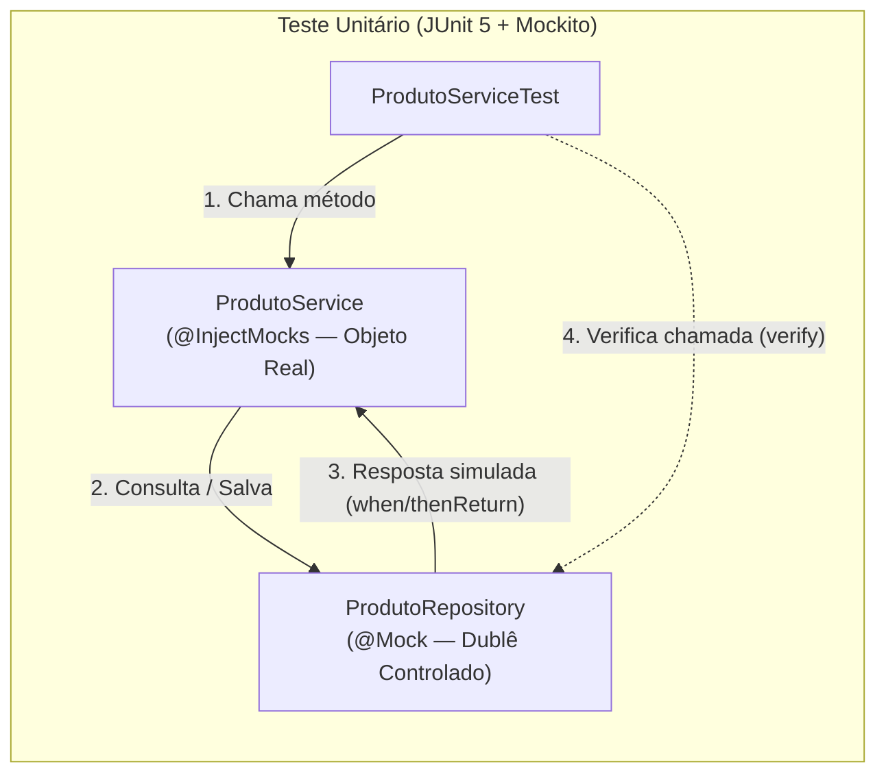

# Aula 02 — Testes Unitários na Camada de Serviço com Spring Boot e Mockito

> **Módulo:** Testes Automatizados  
> **Objetivo da aula:** Compreender o conceito de isolamento em testes unitários, entender por que e quando utilizar dublês de teste (*Mocks* e *Stubs*), e implementar testes unitários para a camada de serviço (`@Service`) de uma aplicação **Spring Boot** utilizando **JUnit 5** e **Mockito**.

---

## 1. Estudo de Caso: Como testar a camada de serviço de uma aplicação Spring Boot?

### O Cenário Real: Evoluindo nosso E-Commerce para Spring Boot

Na Aula 01, testamos classes de cálculo puras (`CalculadoraDesconto`, `CalculadoraFrete`) que não dependiam de nenhuma outra classe: bastava instanciá-las com `new` e chamar o método.

Porém, em uma aplicação **Spring Boot** real, a lógica de negócio mora na camada de **Serviço (`@Service`)**, que depende de outras camadas para funcionar:
* Consulta e grava dados no banco através de um **`@Repository`** (`ProdutoRepository`, `PedidoRepository`).
* Dispara notificações por e-mail ou mensageria através de um serviço externo (`NotificacaoService`).

Observe a classe [`ProdutoService`](../src/main/java/com/ada/demo/aula02/ProdutoService.java):

```java
@Service
public class ProdutoService {

    private final ProdutoRepository produtoRepository;

    public ProdutoService(ProdutoRepository produtoRepository) {
        this.produtoRepository = produtoRepository;
    }

    public Produto cadastrar(Produto produto) {
        if (produtoRepository.existsBySku(produto.getSku())) {
            throw new RegraNegocioException("Já existe um produto cadastrado com o SKU: " + produto.getSku());
        }
        return produtoRepository.save(produto);
    }
}
```

### Onde mora o problema ao tentar testar essa classe?

1. **`ProdutoRepository` é apenas uma interface:** Não podemos fazer `new ProdutoRepository()` no nosso teste, pois quem gera a implementação em tempo de execução é o Spring Data JPA conectado a um banco de dados.
2. **E se usarmos o banco de dados real no teste unitário?**
   * **Lentidão:** Subir o contexto do Spring Boot e conectar ao banco leva vários segundos; em um projeto com 1.000 testes, a suíte demoraria minutos.
   * **Fragilidade (Falsos Negativos):** Se o banco de testes estiver fora do ar ou com dados sujos de outro teste, o teste do `ProdutoService` falha mesmo que a lógica Java do `ProdutoService` esteja perfeita!
   * **Efeitos Colaterais:** Em serviços que enviam e-mail (`NotificacaoService`) ou cobram cartão de crédito, não queremos disparar e-mails reais toda vez que alguém rodar `mvn test`.

> [!IMPORTANT]
> **Princípio do Teste Unitário:** Um teste unitário na camada de serviço deve testar **exclusivamente as regras de negócio do `Service`**, isolando-o do banco de dados, da rede e de serviços externos.

---

## 2. Isolamento de Dependências e Dublês de Teste (Mockito)

Para testar o `ProdutoService` de forma rápida e isolada, substituímos suas dependências reais (`ProdutoRepository`, `NotificacaoService`) por **Dublês de Teste** (*Test Doubles*) gerenciados pelo framework **Mockito**.



### Principais Anotações e Métodos do Mockito

| Recurso | Papel no Teste | Exemplo |
| :--- | :--- | :--- |
| **`@ExtendWith(MockitoExtension.class)`** | Ativa o Mockito no JUnit 5 **sem subir o Spring Boot** (execução em milissegundos). | Anotado na classe de teste |
| **`@Mock`** | Cria um objeto simulado (dublê) de uma interface ou classe. Por padrão, seus métodos não fazem nada e retornam vazio/`null`/`false`. | `@Mock private ProdutoRepository repository;` |
| **`@InjectMocks`** | Instancia a classe real que queremos testar e injeta automaticamente os `@Mock`s no construtor dela. | `@InjectMocks private ProdutoService service;` |
| **`when(...).thenReturn(...)`** | Ensina o Mock a devolver um valor específico quando for chamado (**Stubbing** — etapa *Arrange*). | `when(repo.existsBySku("ABC")).thenReturn(false);` |
| **`verify(mock).metodo(...)`** | Verifica se o `Service` realmente chamou determinado método do Mock (**Verificação de Comportamento** — etapa *Assert*). | `verify(repo).save(produto);` |
| **`verify(mock, never()).metodo(...)`** | Garante que um método **nunca** foi chamado (essencial em fluxos de erro!). | `verify(repo, never()).save(any());` |

---

### Exemplo Prático: Testando `ProdutoService` com JUnit 5 e Mockito

Veja como testamos tanto o caminho feliz quanto um fluxo de exceção em [`ProdutoServiceTest`](../src/test/java/com/ada/demo/aula02/ProdutoServiceTest.java):

```java
@ExtendWith(MockitoExtension.class)
class ProdutoServiceTest {

    @Mock
    private ProdutoRepository produtoRepository;

    @InjectMocks
    private ProdutoService produtoService;

    @Test
    @DisplayName("Deve cadastrar produto com sucesso quando o SKU for inédito")
    void deveCadastrarProdutoComSucesso() {
        // 1. Arrange (Preparar dados e comportamento dos Mocks)
        Produto novo = new Produto(null, "Notebook", "NOTE-01", 4500.0, 10, true);
        Produto salvo = new Produto(1L, "Notebook", "NOTE-01", 4500.0, 10, true);

        when(produtoRepository.existsBySku("NOTE-01")).thenReturn(false);
        when(produtoRepository.save(novo)).thenReturn(salvo);

        // 2. Act (Executar o método real do Service)
        Produto resultado = produtoService.cadastrar(novo);

        // 3. Assert (Verificar estado retornado + interações com o Mock)
        assertNotNull(resultado.getId());
        assertEquals(1L, resultado.getId());
        verify(produtoRepository).save(novo);
    }

    @Test
    @DisplayName("Deve lançar exceção quando SKU já existir e NÃO deve salvar no banco")
    void deveLancarExcecaoQuandoSkuJaExistir() {
        // 1. Arrange
        Produto duplicado = new Produto(null, "Mouse", "MOUSE-99", 150.0, 5, true);
        when(produtoRepository.existsBySku("MOUSE-99")).thenReturn(true);

        // 2. Act & 3. Assert
        assertThrows(
                RegraNegocioException.class,
                () -> produtoService.cadastrar(duplicado)
        );

        // Garante que o banco jamais foi acionado para salvar o produto inválido!
        verify(produtoRepository, never()).save(any());
    }
}
```

---

## 3. Boas Práticas e Armadilhas Comuns na Camada de Serviço

### `@ExtendWith(MockitoExtension.class)` vs. `@SpringBootTest`

Uma dúvida muito comum ao iniciar testes em projetos Spring Boot é qual anotação colocar no topo da classe de teste:

| Critério | `@ExtendWith(MockitoExtension.class)` | `@SpringBootTest` |
| :--- | :--- | :--- |
| **Tipo de Teste** | **Teste Unitário Puro** | **Teste de Integração** (veremos na Aula 06) |
| **O que sobe na memória?** | Apenas a instância da classe testada e os Mocks | Todo o contexto do Spring, conexões JPA, H2, Beans e filtros Web |
| **Tempo médio de execução** | ~10 a 50 milissegundos | ~3 a 10 segundos |
| **Quando usar?** | Testar regras de negócio de um `@Service` isoladamente | Testar se todas as camadas reais funcionam juntas ponta a ponta |

### Por que verificar tanto o Estado (`assertEquals`) quanto o Comportamento (`verify`)?

Imagine um método que processa um pedido e precisa:
1. Retornar o objeto `Pedido` confirmado;
2. Abater a quantidade no estoque e salvar no `ProdutoRepository`;
3. Enviar um e-mail pelo `NotificacaoService` (cujo método é `void`).

Se usarmos apenas `assertEquals(StatusPedido.CONFIRMADO, pedido.getStatus())`, não teremos certeza se o método `notificacaoService.enviarConfirmacaoPedido(...)` foi chamado! É aí que o `verify(notificacaoService).enviarConfirmacaoPedido(...)` se torna indispensável.

---

## 4. Pesquisa Individual Guiada (20 minutos)

Consulte a documentação oficial do **[Mockito Javadoc](https://javadoc.io/doc/org.mockito/mockito-core/latest/org/mockito/Mockito.html)** e do **[JUnit 5 User Guide](https://junit.org/junit5/docs/current/user-guide/)** e responda às 4 questões abaixo:

1. **Simulando exceções em dependências:** Usamos `when(...).thenReturn(...)` quando queremos que o Mock devolva um valor normal. Qual método do Mockito usamos junto ao `when(...)` quando queremos simular que o banco de dados ou serviço externo **lançou uma exceção**? E como fazemos isso quando o método do Mock retorna `void`?
2. **Quantas vezes foi chamado?** No método `verify(mock, modo).metodo()`, além de `never()`, quais funções o Mockito oferece para verificar que um método foi chamado **exatamente N vezes** ou **pelo menos uma vez**?
3. **Capturando argumentos criados dentro do Service:** Às vezes, o próprio `Service` dá um `new Pedido(...)` internamente e o passa para `pedidoRepository.save(novoPedido)`. Qual classe/anotação do Mockito permite **capturar** o objeto exato que foi passado para o `save()` a fim de inspecionarmos seus campos no teste?
4. **Mocks não utilizados (`UnnecessaryStubbingException`):** O que acontece no Mockito moderno (com `MockitoExtension`) se você configurar um `when(...).thenReturn(...)` no seu teste, mas o método do `Service` nunca chegar a chamar aquele Mock durante a execução? Por que essa proteção existe?

---

## 5. Exercícios Práticos de Fixação

Agora é a sua vez! No pacote `com.ada.demo.aula02`, abra a classe [`PedidoService.java`](../src/main/java/com/ada/demo/aula02/PedidoService.java), que depende de **três colaboradores**:
* `PedidoRepository`
* `ProdutoRepository`
* `NotificacaoService`

Crie (ou complete) a suíte de testes [`PedidoServiceTest.java`](../src/test/java/com/ada/demo/aula02/PedidoServiceTest.java) utilizando `@ExtendWith(MockitoExtension.class)`, `@Mock` e `@InjectMocks`:

### Exercício 1 — Criação de Pedido com Sucesso (Caminho Feliz)
Implemente o teste para `criarPedido(emailCliente, produtoId, quantidade)` quando todos os dados são válidos:
* Simule `produtoRepository.findById(1L)` retornando um `Produto` ativo com estoque `10` e preço `1000.0`.
* Simule `pedidoRepository.save(any(Pedido.class))` retornando o pedido salvo.
* Verifique se:
  1. O valor total calculado do pedido é `2000.0` (para quantidade `2`) e o status é `StatusPedido.CONFIRMADO`.
  2. O estoque do produto caiu de `10` para `8` e `produtoRepository.save(produto)` foi chamado.
  3. O método `notificacaoService.enviarConfirmacaoPedido(...)` foi chamado **exatamente 1 vez**.

### Exercício 2 — Validações e Regras de Negócio na Criação do Pedido
Implemente testes unitários cobrindo os cenários de erro de `criarPedido`:
1. **Produto não encontrado:** Quando `findById` retorna `Optional.empty()`, deve lançar `RecursoNaoEncontradoException`.
2. **Produto inativo:** Quando `produto.isAtivo()` é `false`, deve lançar `RegraNegocioException`.
3. **Estoque insuficiente:** Quando a quantidade solicitada é maior que `produto.getQuantidadeEstoque()`, deve lançar `RegraNegocioException`.
4. **Garantia de segurança nos 3 cenários acima:** Utilize `verify(..., never())` ou `verifyNoInteractions(...)` para provar que **nenhum pedido foi salvo** e **nenhum e-mail foi enviado** quando ocorre erro!

### Exercício 3 (Desafio Extra) — Cancelamento de Pedido e Estorno de Estoque
Analise o método `cancelarPedido(Long pedidoId)` em [`PedidoService.java`](../src/main/java/com/ada/demo/aula02/PedidoService.java) e implemente os testes para:
1. **Cancelamento com sucesso:** Dado um pedido com status `CONFIRMADO` (quantidade `2`) e um produto com estoque atual `8`, ao cancelar o pedido:
   * O status do pedido deve mudar para `StatusPedido.CANCELADO`.
   * O estoque do produto deve voltar para `10` (`8 + 2`) e ser salvo no `produtoRepository`.
   * `notificacaoService.enviarCancelamentoPedido(...)` deve ser chamado.
2. **Bloqueio de cancelamento:** Tentar cancelar um pedido cujo status já é `StatusPedido.ENVIADO` ou `StatusPedido.CANCELADO` deve lançar `RegraNegocioException`, sem alterar o estoque e sem disparar notificação.
